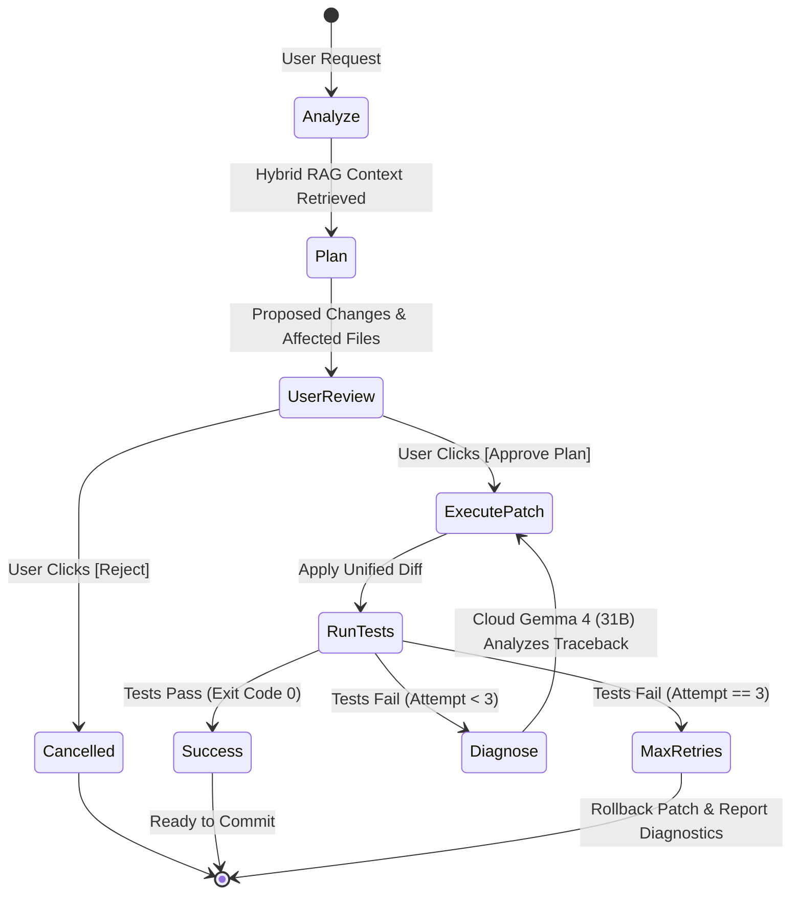

# Codebase Copilot: Repository Intelligence & Coding Agent Platform

> **A production-ready, cloud-accelerated AI coding agent and repository intelligence platform with a TypeScript VS Code extension, Python FastAPI intelligence backend, AST/Tree-sitter structural analysis, hybrid code-graph retrieval, cloud-hosted Gemma 4 (31B) model, and VS Code SecretStorage compliance.**

---

## Table of Contents
1. [Executive Summary & Core Value Proposition](#1-executive-summary--core-value-proposition)
2. [High-Level Architecture](#2-high-level-architecture)
3. [Cloud LLM Architecture: Gemma 4 (31B)](#3-cloud-llm-architecture-gemma-4-31b)
4. [VS Code Marketplace & Enterprise Compliance](#4-vs-code-marketplace--enterprise-compliance)
5. [Code Intelligence & Structural AST Pipeline](#5-code-intelligence--structural-ast-pipeline)
6. [Code Knowledge Graph & Hybrid Retrieval (RAG)](#6-code-knowledge-graph--hybrid-retrieval-rag)
7. [Agentic Execution Engine & Self-Healing Repair Loop](#7-agentic-execution-engine--self-healing-repair-loop)
8. [Patch Modification & Safe File Engine](#8-patch-modification--safe-file-engine)
9. [Zero-Leak Privacy & Secret Masking Pipeline](#9-zero-leak-privacy--secret-masking-pipeline)
10. [VS Code Extension & TypeScript UI Layer](#10-vs-code-extension--typescript-ui-layer)
11. [Repository Structure & Technology Stack](#11-repository-structure--technology-stack)
12. [Step-by-Step Implementation Roadmap](#12-step-by-step-implementation-roadmap)
13. [Portfolio & Resume Presentation Guide](#13-portfolio--resume-presentation-guide)

---

## 1. Executive Summary & Core Value Proposition

Standard coding assistants (like basic chat panels or copilot completions) suffer from two major problems:
1. **Lack of Whole-Repository Architectural Context:** They inspect only the active file or top-matching chunks, failing to trace multi-file execution paths (e.g., `Page -> Service -> Controller -> Database`).
2. **Impractical Hardware Requirements for Real Users:** Running large 30B+ parameter models locally requires 20GB–24GB+ of dedicated VRAM, making local installation impossible for developers on standard laptops or MacBooks.

**Codebase Copilot** bridges this divide by decoupling **structural indexing** (performed locally in your IDE) from **deep model reasoning** (powered by a cloud-hosted **Gemma 4 31B**):
- **Lightweight for End-Users:** Works on any developer machine (macOS, Windows, Linux) without requiring high-end GPUs.
- **Structural AST Parsing:** Parses code into Abstract Syntax Trees (AST) using Python AST and Tree-sitter to preserve exact classes, signatures, docstrings, and decorators.
- **Relational Code Graph (SQLite) + Vector Retrieval (ChromaDB):** Combines vector similarity with relational call-graph traversal using Reciprocal Rank Fusion (RRF).
- **Safe Multi-File Patching:** Proposes surgical unified diffs rather than destructive whole-file rewrites.
- **Automated Self-Healing Error Loop:** Runs test suites (`pytest`, `npm test`), catches tracebacks, and iteratively repairs code (up to 3 bounded attempts).
- **Enterprise-Grade Privacy & Marketplace Compliance:** Stores credentials inside the OS Keychain via VS Code's `SecretStorage` API and scrubs sensitive secrets/`.env` values before sending prompts to the cloud.

---

## 2. High-Level Architecture

```mermaid
flowchart TB
    subgraph VSCode["VS Code Environment (Client)"]
        UI["TypeScript Webview Sidebar<br/>• Chat & Quick Actions<br/>• Interactive Diff Viewer<br/>• Architecture Visualizer (Mermaid)<br/>• Privacy Filter Status"]
        ExtHost["Extension Host (TypeScript)<br/>• Commands & Event Handlers<br/>• Workspace File Watcher<br/>• SecretStorage (OS Keychain)<br/>• Diagnostics Listener"]
        UI <--> ExtHost
    end

    subgraph Backend["Python FastAPI Intelligence Engine (Local)"]
        API["FastAPI Gateway (HTTP / WebSockets)"]
        
        subgraph PrivacyGuard["Zero-Leak Privacy Guard"]
            SecretFilter["Regex Secret & Token Scrubber"]
            FileBlacklist["Ignore Scanner (.env, .pem, keys)"]
        end

        subgraph ParserEngine["Structural Parser"]
            AST["Python AST Parser"]
            TS["Tree-sitter Multi-Language Engine"]
            SymbolExtractor["Symbol & Relationship Extractor"]
        end

        subgraph StorageLayer["Indexing & Knowledge Layer"]
            SQLite["SQLite Graph Store<br/>(Calls, Imports, Inheritance)"]
            Chroma["ChromaDB Vector Store<br/>(Code Chunks & Embeddings)"]
        end

        subgraph RetrievalEngine["Hybrid Search Engine"]
            RRF["Reciprocal Rank Fusion (RRF)<br/>(Vector + BM25 + Graph Traversal)"]
        end

        subgraph AgentEngine["Coding Agent Engine"]
            Planner["Task Decomposition Planner"]
            Patcher["Unified Diff Patch Engine"]
            RepairLoop["Bounded Self-Healing Test Loop"]
            ToolBus["Sandboxed Tool Dispatcher"]
        end
    end

    subgraph CloudAI["Cloud AI Services (HTTPS / TLS 1.3)"]
        GemmaCloud["Cloud Gemma 4 (31B)<br/>• Deep Reasoning & Planning<br/>• Multi-File Code Synthesis<br/>• Error Diagnosis"]
        CloudEmbed["Cloud / Local Embeddings Engine"]
    end

    ExtHost <-->|Secure Localhost (HTTP/WS)| API
    ExtHost -.->|Encrypted Token via SecretStorage| API
    API --> PrivacyGuard
    PrivacyGuard --> ParserEngine
    ParserEngine --> StorageLayer
    StorageLayer --> RetrievalEngine
    RetrievalEngine --> AgentEngine
    AgentEngine -->|Sanitized Context & Tools| GemmaCloud
    RetrievalEngine <--> CloudEmbed
    AgentEngine --> Patcher
    Patcher -->|Diff Preview| ExtHost
```

---

## 3. Cloud LLM Architecture: Gemma 4 (31B)

### 3.1 Why Cloud Gemma 4 (31B)?
- **High Parameter Capacity for Agentic Tasks:** 31B parameter models strike the optimal balance between top-tier coding ability, precise tool calling, structured JSON output, and cost efficiency.
- **Zero Local Hardware Barrier:** Real-time users do not need an RTX 4090 or Apple M-Max chip. Even a lightweight ultrabook can run the extension smoothly.
- **Low Latency & High Throughput:** High tokens/sec on cloud infrastructure ensures rapid streaming responses during complex multi-step planning.

### 3.2 Cloud Provider Connectivity Options
The backend implements a modular `BaseLLMProvider` that can connect to Gemma 4 (31B) through:
1. **Google Cloud Vertex AI / AI Studio** (Native Gemma endpoints)
2. **OpenAI-Compatible Cloud Gateways** (e.g., Groq, Together AI, OpenRouter, vLLM cloud cluster)

### 3.3 Python Provider Implementation (`backend/app/llm/gemma_provider.py`)
```python
import os
from typing import AsyncGenerator, Dict, Any, List
import httpx
from pydantic import BaseModel

class GemmaCloudProvider:
    """
    Client for Cloud-hosted Gemma 4 (31B) supporting streaming,
    structured JSON output, and tool-calling protocols.
    """
    def __init__(
        self,
        api_key: str,
        endpoint_url: str = "https://api.together.xyz/v1",
        model_name: str = "google/gemma-4-31b-it"
    ):
        self.api_key = api_key
        self.endpoint_url = endpoint_url
        self.model_name = model_name
        self.headers = {
            "Authorization": f"Bearer {self.api_key}",
            "Content-Type": "application/json"
        }

    async def chat(self, messages: List[Dict[str, str]], temperature: float = 0.2) -> str:
        async with httpx.AsyncClient(timeout=60.0) as client:
            payload = {
                "model": self.model_name,
                "messages": messages,
                "temperature": temperature,
                "stream": False
            }
            res = await client.post(f"{self.endpoint_url}/chat/completions", json=payload, headers=self.headers)
            res.raise_for_status()
            return res.json()["choices"][0]["message"]["content"]

    async def stream_chat(self, messages: List[Dict[str, str]], temperature: float = 0.2) -> AsyncGenerator[str, None]:
        async with httpx.AsyncClient(timeout=120.0) as client:
            payload = {
                "model": self.model_name,
                "messages": messages,
                "temperature": temperature,
                "stream": True
            }
            async with client.stream("POST", f"{self.endpoint_url}/chat/completions", json=payload, headers=self.headers) as response:
                response.raise_for_status()
                async for line in response.aiter_lines():
                    if line.startswith("data: ") and line.strip() != "data: [DONE]":
                        import json
                        chunk = json.loads(line[6:])
                        delta = chunk["choices"][0].get("delta", {}).get("content", "")
                        if delta:
                            yield delta
```

---

## 4. VS Code Marketplace & Enterprise Compliance

To publish this extension on the official **Visual Studio Code Marketplace** for production users, the project adheres to Microsoft's strict extension guidelines:

### 4.1 Secure Credential Storage (`vscode.SecretStorage`)
- **Rule:** Extensions must never store API tokens or secrets in plain text, `package.json`, or user `settings.json`.
- **Implementation:** Utilize the native `context.secrets` API backed by OS-level encryption:
  - macOS: **Keychain**
  - Linux: **Secret Service / libsecret**
  - Windows: **Windows Credential Manager**

#### TypeScript Integration (`extension/src/auth/SecretManager.ts`):
```typescript
import * as vscode from 'vscode';

export class SecretManager {
    private static readonly SECRET_KEY = 'codebase_copilot.gemma_api_key';

    constructor(private context: vscode.ExtensionContext) {}

    async storeApiKey(apiKey: string): Promise<void> {
        await this.context.secrets.store(SecretManager.SECRET_KEY, apiKey);
    }

    async getApiKey(): Promise<string | undefined> {
        return await this.context.secrets.get(SecretManager.SECRET_KEY);
    }

    async deleteApiKey(): Promise<void> {
        await this.context.secrets.delete(SecretManager.SECRET_KEY);
    }
}
```

### 4.2 Marketplace Security & Privacy Checklist
| Requirement | Status | Project Implementation |
| :--- | :--- | :--- |
| **Encrypted API Keys** | Compliant | Stored exclusively via `vscode.SecretStorage`. |
| **No Silent Code Changes** | Compliant | All file modifications require user confirmation via the Patch Reviewer. |
| **No Silent Terminal Commands**| Compliant | Terminal/test commands are logged with explicit execution consent. |
| **Clean Process Lifecycle** | Compliant | The Python backend sidecar stops automatically when VS Code closes. |
| **Explicit Privacy Policy** | Compliant | Includes `PRIVACY.md` detailing HTTPS transport and local secret scrubbing. |

---

## 5. Code Intelligence & Structural AST Pipeline

### 5.1 Code-Aware Chunking vs. Naive Token Splitting
Naive RAG breaks code every $N$ tokens, slicing functions in half and divorcing methods from class context. 

Codebase Copilot uses **AST-based structural boundary extraction**:
1. **Modules:** Captures file-level imports, module docstrings, and global variables.
2. **Classes:** Captures name, docstring, inheritance bases, and constructor signatures.
3. **Functions/Methods:** Captures decorators (`@router.post`), complete argument types, return annotations, docstrings, and body statements.

```
┌────────────────────────────────────────────────────────┐
│ file: backend/auth/service.py                          │
│                                                        │
│ ┌─ Chunk 1: Module Level Context ────────────────────┐ │
│ │ imports: [jwt, datetime, UserRepository]           │ │
│ └────────────────────────────────────────────────────┘ │
│                                                        │
│ ┌─ Chunk 2: Class Node (AuthService) ────────────────┐ │
│ │ class AuthService:                                 │ │
│ │     def __init__(self, repo: UserRepository): ...  │ │
│ └────────────────────────────────────────────────────┘ │
│                                                        │
│ ┌─ Chunk 3: Method Node (AuthService.login) ─────────┐ │
│ │ @router.post("/login")                             │ │
│ │ def login(username, password) -> Token:            │ │
│ │     # full body preserved without truncation       │ │
│ └────────────────────────────────────────────────────┘ │
└────────────────────────────────────────────────────────┘
```

### 5.2 AST Symbol Metadata Schema
Each chunk stored in the database carries rich semantic markers:
```json
{
  "chunk_id": "backend/auth/service.py#AuthService.login",
  "file_path": "backend/auth/service.py",
  "symbol_type": "method",
  "symbol_name": "AuthService.login",
  "parent_class": "AuthService",
  "language": "python",
  "start_line": 42,
  "end_line": 84,
  "decorators": ["@router.post('/login')"],
  "signature": "def login(self, username: str, password: str) -> TokenResponse:",
  "docstring": "Authenticates user credentials against the database and returns signed JWT.",
  "calls": ["UserRepository.get_by_username", "verify_password", "jwt.encode"],
  "imports": ["jwt", "datetime", "UserRepository"],
  "content": "@router.post(\"/login\")\ndef login(self, username: str...): ..."
}
```

---

## 6. Code Knowledge Graph & Hybrid Retrieval (RAG)

### 6.1 Relational Graph (SQLite)
Instead of forcing the user to install a dedicated graph database, relationships are indexed locally into embedded **SQLite**:

```sql
CREATE TABLE symbols (
    id TEXT PRIMARY KEY,
    name TEXT NOT NULL,
    symbol_type TEXT NOT NULL, -- 'class', 'function', 'variable', 'route'
    file_path TEXT NOT NULL,
    start_line INTEGER,
    end_line INTEGER,
    signature TEXT
);

CREATE TABLE relationships (
    id INTEGER PRIMARY KEY AUTOINCREMENT,
    source_symbol TEXT,
    target_symbol TEXT,
    relation_type TEXT, -- 'calls', 'imports', 'inherits', 'instantiates'
    file_path TEXT,
    line_number INTEGER,
    FOREIGN KEY(source_symbol) REFERENCES symbols(id)
);
```

### 6.2 Hybrid Retrieval with Reciprocal Rank Fusion (RRF)
When a user asks: *"Where is authentication handled and how does it connect to the database?"*

1. **Semantic Vector Search (ChromaDB):** Retrieves chunks discussing passwords, tokens, hashing, and credentials.
2. **Lexical / Symbol Search (SQLite / BM25):** Retrieves exact symbol matches for `AuthService`, `verify_jwt`, `TokenPayload`.
3. **Graph Traversal:** Follows relationships in SQLite (e.g. `login_route` $\rightarrow$ calls $\rightarrow$ `AuthService.login` $\rightarrow$ calls $\rightarrow$ `UserRepository.get_by_username` $\rightarrow$ writes $\rightarrow$ `Database`).
4. **Reciprocal Rank Fusion (RRF):**
   $$RRF\_Score(d) = \sum_{m \in M} \frac{1}{k + rank_m(d)}$$
   (with $k = 60$, unifying vector score, lexical score, and graph proximity rank).

---

## 7. Agentic Execution Engine & Self-Healing Repair Loop

### 7.1 Multi-File Coding Flow


### 7.2 Bounded Error-Repair Algorithm (`MAX_REPAIR_ATTEMPTS = 3`)
```python
MAX_REPAIR_ATTEMPTS = 3

async def execute_agent_task(prompt: str, affected_files: List[str]):
    attempt = 0
    while attempt < MAX_REPAIR_ATTEMPTS:
        attempt += 1
        # Run workspace test runner
        test_run = await terminal_tools.run_test_suite()
        if test_run.exit_code == 0:
            return {"status": "SUCCESS", "attempts": attempt, "diff": await git_tools.get_diff()}

        # Build diagnostic context for Gemma 4 (31B)
        diagnostic_payload = {
            "stdout": test_run.stdout,
            "stderr": test_run.stderr,
            "failed_tests": test_run.failing_tests,
            "attempt": attempt,
            "current_diff": await git_tools.get_diff()
        }

        # Request corrective unified patch
        repair_patch = await gemma_agent.generate_repair_patch(prompt, diagnostic_payload)
        await patch_engine.apply_unified_diff(repair_patch)

    # If unresolved after 3 attempts, rollback to avoid dirty state
    await git_tools.revert_uncommitted_changes()
    return {"status": "FAILED", "reason": "Max repair iterations reached"}
```

---

## 8. Patch Modification & Safe File Engine

### 8.1 Unified Diff Protocol
The LLM is strictly prohibited from rewriting entire files. Instead, it generates clean **Unified Diffs**:
```diff
--- a/backend/routes/auth.py
+++ b/backend/routes/auth.py
@@ -14,6 +14,8 @@
 from fastapi import APIRouter, Depends, HTTPException
 from backend.services.auth import AuthService
+from backend.auth.jwt import create_access_token
 
 router = APIRouter(prefix="/auth")
 
 @router.post("/login")
 def login(user_data: UserLoginRequest):
     user = AuthService.authenticate(user_data.username, user_data.password)
     if not user:
         raise HTTPException(status_code=401, detail="Invalid credentials")
+    access_token = create_access_token(data={"sub": user.username})
+    return {"access_token": access_token, "token_type": "bearer"}
```

### 8.2 Safety Verification Gates
1. **Target Validation:** Checks that the target file exists and line anchors match.
2. **AST Pre-Compilation:** Before committing to disk, the patched content is parsed through `ast.parse()` or `tree-sitter`. If a syntax error is introduced, the patch is rejected immediately.
3. **VS Code Diff Preview:** Uses VS Code's native `vscode.diff` editor command to show side-by-side modifications before disk writing.

---

## 9. Zero-Leak Privacy & Secret Masking Pipeline

Because Gemma 4 (31B) runs in the cloud, enterprise compliance requires an automated **Privacy Guard**:

### 9.1 Sensitive File Blacklist
Files matching these patterns are excluded from the index and never sent to cloud APIs:
- `.env*`, `*.pem`, `*.key`, `id_rsa`, `*.pfx`, `credentials.json`
- Build artifacts: `node_modules/`, `venv/`, `dist/`, `.git/`, `target/`

### 9.2 In-Flight Secret Masker
Before any prompt or code chunk is transmitted via HTTPS, an automated regex pipeline scrubs known credential formats:
- **AWS Access Keys:** `AKIA[0-9A-Z]{16}` $\rightarrow$ `[REDACTED_AWS_KEY]`
- **Bearer Tokens / Passwords:** `(?i)(password|secret|token|api_key)\s*=\s*['\"][^'\"]+['\"]`
- **Private Key Blocks:** `-----BEGIN [A-Z ]+ PRIVATE KEY-----`

---

## 10. VS Code Extension & TypeScript UI Layer

### 10.1 Key UI Elements
- **Interactive Chat & Streaming Panel:**
  - Real-time token streaming from Cloud Gemma 4 (31B).
  - Clickable markdown citations (e.g. `[service.py:42]`) that open the file directly in the editor.
- **Quick Action Triggers:**
  - 🔍 `Analyze Repository` (Generates full symbol & relationship index)
  - 🏗️ `Show Architecture Diagram` (Renders interactive Mermaid graph)
  - 💡 `Explain Selected Function` (AST context + cloud explanation)
  - 🧪 `Run & Repair Tests` (Executes tests and triggers the self-healing loop)
- **Interactive Patch Reviewer:**
  - Shows estimated file changes (`+2 files, ~1 file, 38 lines`).
  - Buttons: `[✓ Approve & Apply Patches]` and `[✕ Reject]`.
- **API Key & Status Badge:**
  - Displays connection state (`● Cloud Gemma 4 (31B) Connected`).
  - Native password prompt when configuring API keys.

---

## 11. Repository Structure & Technology Stack

```
codebase-copilot/
├── extension/                       # TypeScript VS Code Extension
│   ├── package.json                 # Extension manifest, commands, permissions
│   ├── tsconfig.json
│   ├── src/
│   │   ├── extension.ts             # Entrypoint & command registration
│   │   ├── auth/
│   │   │   └── SecretManager.ts     # VS Code SecretStorage (OS Keychain)
│   │   ├── api/
│   │   │   └── backendClient.ts     # Communication with local FastAPI backend
│   │   ├── diff/
│   │   │   └── diffViewer.ts        # Native VS Code side-by-side diff
│   │   └── webview/
│   │       ├── SidebarProvider.ts   # Webview View Provider
│   │       └── media/
│   │           ├── main.js          # Chat, streaming, and button handlers
│   │           ├── style.css         # Modern dark-mode interface
│   │           └── mermaid.min.js   # Dynamic architecture graph rendering
│   │
├── backend/                         # Python Intelligence Engine
│   ├── requirements.txt
│   ├── pyproject.toml
│   ├── app/
│   │   ├── main.py                  # FastAPI server & WebSocket endpoints
│   │   ├── config.py                # App configuration
│   │   ├── security/
│   │   │   ├── secret_masker.py     # Regex secret scrubber
│   │   │   └── file_filter.py       # .gitignore and sensitive file blacklist
│   │   ├── parser/
│   │   │   ├── ast_chunker.py       # Python AST class/function splitter
│   │   │   ├── treesitter_chunker.py# Multi-language Tree-sitter parser
│   │   │   └── symbols.py           # Symbol & relationship data structures
│   │   ├── index/
│   │   │   ├── graph_store.py       # SQLite symbol & relationship storage
│   │   │   └── vector_store.py      # ChromaDB embeddings integration
│   │   ├── retrieval/
│   │   │   ├── hybrid_search.py     # RRF (Vector + Lexical + Graph)
│   │   │   └── context_builder.py   # Prompt assembly & token budgeter
│   │   ├── agent/
│   │   │   ├── planner.py           # Task decomposition planner
│   │   │   ├── patch_engine.py      # Unified diff parser and AST validator
│   │   │   ├── repair_loop.py       # Bounded test-execution error-repair loop
│   │   │   └── tools/
│   │   │       ├── terminal_agent.py# Sandboxed pytest/npm test runner
│   │   │       └── git_agent.py     # Git status, diff, and rollback manager
│   │   └── llm/
│   │       └── gemma_provider.py    # Cloud Gemma 4 (31B) API client
│   └── tests/
│       ├── test_ast_parser.py
│       ├── test_patch_engine.py
│       └── test_secret_masker.py
│
├── docs/
│   ├── architecture.md
│   └── compliance.md
├── README.md
└── CODEBASE_COPILOT_SPEC.md
```

### Technology Matrix
| Component | Technology | Rationale |
| :--- | :--- | :--- |
| **Extension Client** | TypeScript, VS Code Webview API | Native IDE integration, high responsiveness, type-safe |
| **Credential Security**| `vscode.SecretStorage` | Encrypted in OS Keychain; compliant with VS Code Marketplace rules |
| **Backend Engine** | Python 3.11+, FastAPI, Uvicorn | Rich AI ecosystem, native AST support, async WebSocket streaming |
| **Code Reasoning LLM**| **Cloud Gemma 4 (31B)** | Deep reasoning, multi-file planning, low latency, no local GPU load |
| **Code Parser** | Python `ast` + `tree-sitter` | Exact semantic boundary chunking (methods, classes, imports) |
| **Graph Database** | SQLite (`sqlite3`) | Embedded, zero-configuration local graph storage for call trees |
| **Vector Database** | ChromaDB (`chromadb`) | Embedded local vector store for fast semantic retrieval |
| **Architecture UI** | Mermaid.js | Dynamic, interactive dependency visualizer in the sidebar |

---

## 12. Step-by-Step Implementation Roadmap

```mermaid
gantt
    title Codebase Copilot Roadmap (Gemma 4 Cloud + TS UI)
    dateFormat  X
    axisFormat  Day %d

    section Phase 1: Core Setup
    Scaffold TypeScript Extension & Webview :active, p1_1, 0, 3
    FastAPI Gateway & Cloud Gemma 4 Client  :p1_2, 2, 5
    SecretStorage API Key Flow             :p1_3, 4, 6

    section Phase 2: Structural Indexing
    Workspace Scanner & Secret Masking     :p2_1, 5, 8
    AST & Tree-sitter Code Chunker         :p2_2, 7, 11
    ChromaDB & SQLite Graph Population     :p2_3, 9, 13

    section Phase 3: Hybrid Retrieval
    Reciprocal Rank Fusion (RRF) Pipeline  :p3_1, 12, 16
    Context Builder with Token Budgets     :p3_2, 14, 18

    section Phase 4: Coding Agent
    Planner with Gemma 4 (31B)             :p4_1, 17, 21
    Unified Diff Engine & VS Code Preview  :p4_2, 19, 23

    section Phase 5: Self-Healing & UI
    Test Runner & Error-Repair Loop        :p5_1, 22, 26
    Repository Health & Mermaid Graphs     :p5_2, 24, 28
```



---

## 13. Portfolio & Resume Presentation Guide

### 13.1 Resume Bullet Points
- **Architecture & Full-Stack System Design:**
  > *"Architected an AI-powered repository intelligence and autonomous coding agent for VS Code using TypeScript, Python (FastAPI), AST/Tree-sitter structural code parsing, and cloud-hosted Gemma 4 (31B)."*
- **Advanced Code Retrieval (Graph + RAG):**
  > *"Engineered a hybrid retrieval system combining code-aware AST chunking, SQLite relational call graphs, ChromaDB vector search, and Reciprocal Rank Fusion (RRF) to trace multi-file execution paths."*
- **Agentic Planning & Self-Healing Workflows:**
  > *"Built an autonomous multi-file coding agent featuring structured planning, unified diff patch validation, and a self-healing error-repair loop that runs test suites and iteratively resolves failures."*
- **Security & Marketplace Compliance:**
  > *"Implemented enterprise security controls including OS Keychain API credential storage via VS Code SecretStorage, regex-based secret scrubbing, and user confirmation gates for file modifications."*

### 13.2 Technical Interview Talking Points
1. **Why Cloud Gemma 4 (31B) instead of a local model?**
   > *"A 31B parameter model requires 20GB–24GB+ VRAM, which limits adoption to users with expensive local GPUs. By running Gemma 4 (31B) in the cloud and keeping code parsing, graph indexing, and secret masking local, we achieve top-tier reasoning speeds on any developer laptop with zero local hardware friction."*
2. **How is enterprise privacy maintained with a cloud model?**
   > *"Before any code context leaves the machine, our local Zero-Leak Privacy Guard scans for sensitive files (.env, keys) and scrubs credentials via regex sanitization. Furthermore, API keys are encrypted in the OS Keychain using VS Code's SecretStorage API."*
3. **Why patch diffs rather than full-file code generation?**
   > *"Full-file rewrites are token-inefficient and prone to erasing existing functionality. Using a unified diff patcher with AST pre-compilation guarantees that changes are surgical, verifiable, and visually reviewable by the developer before being applied to disk."*
