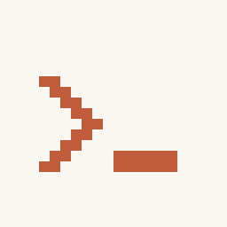
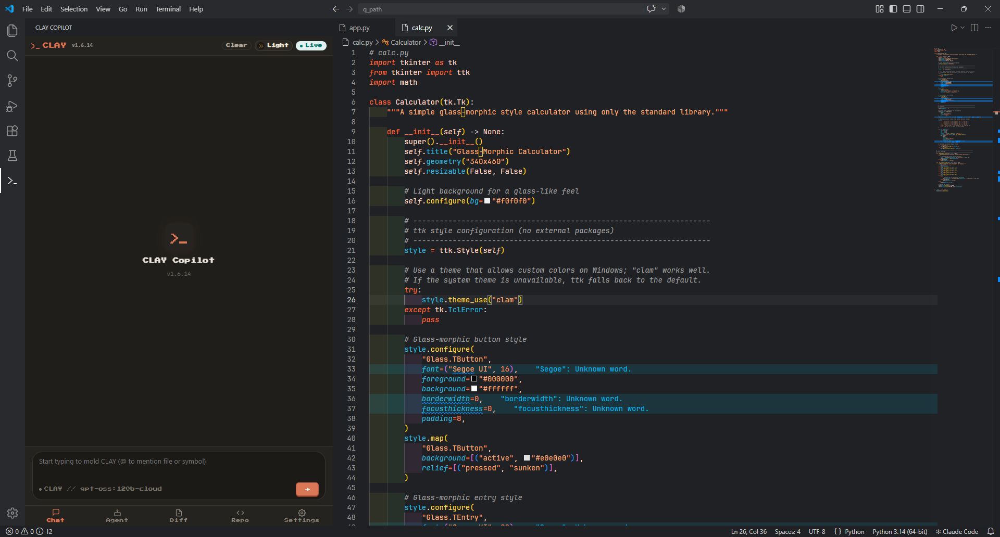
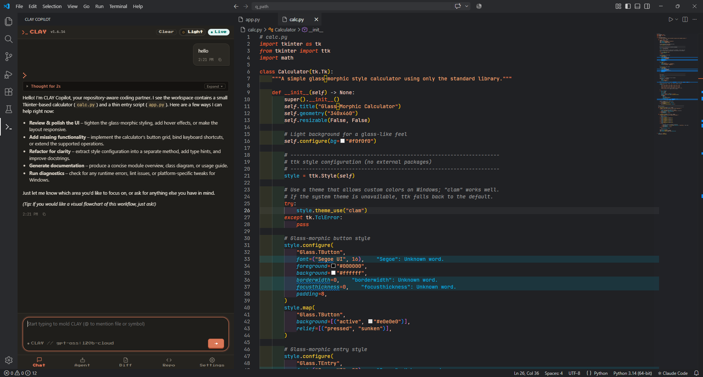
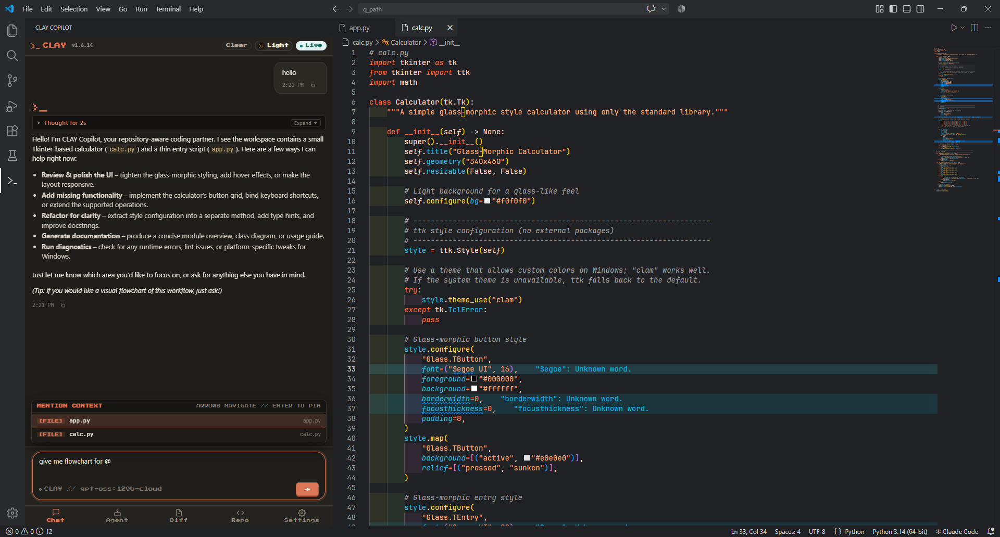
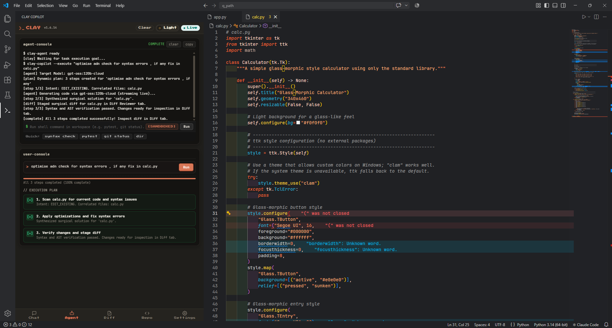
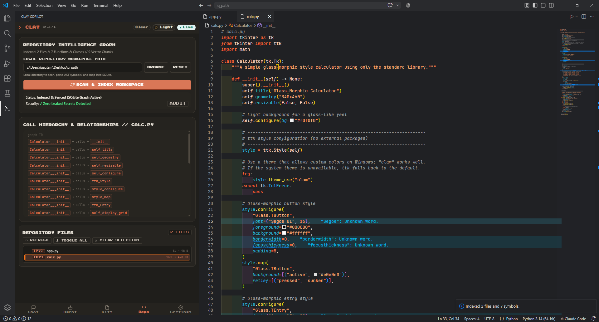
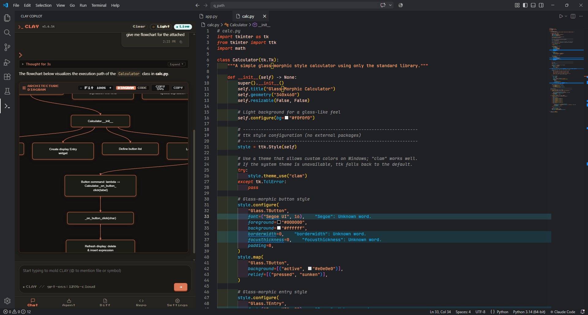
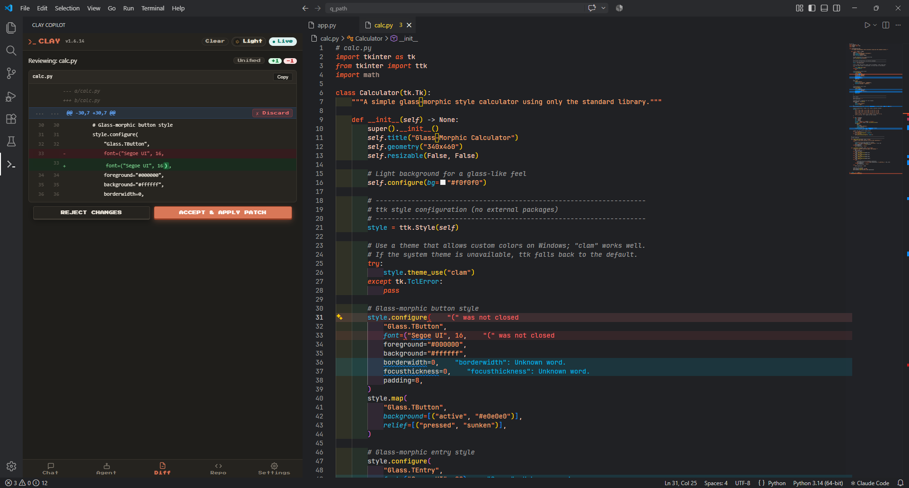
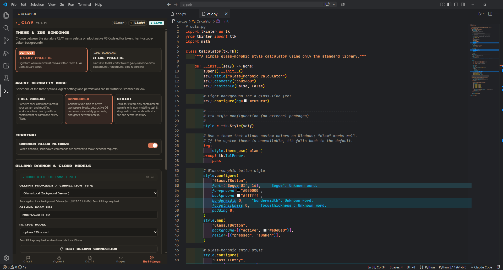

<p align="center">
  
</p>

# CLAY Copilot
### Autonomous Repository Intelligence & Coding Agent Platform for VS Code

[-0078D6?logo=windows&logoColor=white)](https://github.com/ishan2k05/CLAY-copilot/releases)
[](extension/package.json)
[](https://fastapi.tiangolo.com)
[](https://tree-sitter.github.io)
[](LICENSE)
[](https://github.com/ishan2k05/CLAY-copilot)

**CLAY Copilot** is a repository intelligence platform and autonomous software engineering agent built directly into VS Code. Powered by modern LLMs (via local or cloud Ollama), a multi-language **Tree-Sitter AST engine**, an embedded **SQLite relational call graph**, and a **4-stream hybrid RAG retrieval pipeline**, CLAY Copilot navigates, explains, plans, and surgically refactors codebases of any size.

Unlike extensions that require complex Python installations, virtual environments, or external SaaS dependencies, CLAY Copilot ships as a **self-contained standalone application sidecar** -- download, click install, and start coding immediately.

---

## Table of Contents

- [Core Highlights](#core-highlights)
- [The 5 Integrated Workspaces](#the-5-integrated-workspaces)
- [Under the Hood: Dual-Pillar Architecture](#under-the-hood-dual-pillar-architecture)
- [Zero-Dependency Setup (Windows win32-x64)](#zero-dependency-setup-windows-win32-x64)
- [Quick Start & Installation](#quick-start--installation)
- [Key Workflows & Usage](#key-workflows--usage)
- [Security & Zero-Leak Privacy Guard](#security--zero-leak-privacy-guard)
- [Current Limitations](#current-limitations)
- [Known Bugs & Scheduled Fixes](#known-bugs--scheduled-fixes)
- [Development & Contributing](#development--contributing)
- [License](#license)

---

## Core Highlights

- **Zero-Dependency One-Click Install:** Bundled with a native compiled binary (`clay-server.exe`). No Python, pip, or virtual environment configuration required.
- **Embedded Multi-Language Tree-Sitter Engine:** Native AST parsing for **Python, TypeScript, React TSX, JavaScript, Rust, Go, and C/C++** with zero external compiler dependencies.
- **Two-Tier Autonomous Agent:** Dynamic LLM task decomposer that plans multi-step tasks (`scan` -> `prep` -> `synthesize` -> `validate` -> `verify`), executes native terminal processes, and handles live token streaming.
- **Automated 1-Shot Self-Healing Repair:** Catches AST syntax errors, misaligned indentation, and malformed diffs, automatically invoking an internal repair loop to heal the patch before staging.
- **4-Stream RRF Hybrid Search Engine:** Blends SQLite FTS5 BM25 text search, packed binary vector embeddings, structural AST symbols, and relational call graph hops via Reciprocal Rank Fusion.
- **Zero-Leak Privacy Guard:** Client-side regex engine that strips API keys, OAuth tokens, private `.pem` certificates, and `.env` credentials before prompts leave your machine.
- **Multi-Instance Workspace Isolation:** Run multiple CLAY windows concurrently across separate projects with automated dynamic loopback port allocation (`8765-8785`), workspace handshake verification, and isolated per-window lifecycles.
- **Isolated State Management:** User settings persist safely in VS Code's User Application Storage across updates, while repository call graphs remain strictly isolated per workspace.

---

## The 5 Integrated Workspaces

CLAY Copilot provides a custom, responsive, **Warm Minimalist Canvas** sidebar interface divided into five dedicated workspaces:

### 1. Chat Workspace (Conversational Intelligence & Smart Mentions)
- **Token-Budgeted Rolling Compaction:** Multi-turn session memory split into Tier 1 (recent turn buffers) and Tier 2 (rolling semantic summary) to preserve token budget.
- **60fps Smooth Streaming:** RAF-throttled smooth token rendering with an interactive, collapsible internal thinking drawer and live reasoning stopwatch.
- **Smart Mention Chips:** Type `@` to dynamically mention and pin files (`@app.py`), structural symbols (`@UserService`), or directories (`@src/auth`).
- **Interactive Line Citation Pills:** Responses output clickable line citations (e.g., `[auth.py:L14-L32]`) that jump directly to the code in your active editor.

<p align="center">
  
</p>

<p align="center">
  
</p>

#### Smart Context Engine (`@` Mentions)
Pin target symbols, classes, or files directly into the prompt context with fuzzy search:

<p align="center">
  
</p>

---

### 2. Agent Workspace (Autonomous Multi-Step Execution)
- **Dynamic Task Decomposer:** Analyzes user instructions and generates tailored multi-step execution plans with real-time status badges (`[+] Done`, `[>] Active`, `[-] Queued`).
- **Live Terminal Logging:** Embedded subshell monitor displaying real-time compiler, build, and agent execution logs.
- **Interactive Ambiguity Resolution:** When a target file is ambiguous across multiple candidates, the agent pauses, renders selection chips, and resumes immediately upon selection.
- **One-Click Stop & Resume:** Non-blocking abort triggers that cleanly terminate child processes and terminal sessions without freezing the editor.

<p align="center">
  
</p>

---

### 3. Repo Workspace (Repository Map & Symbol Graph)
- **Universal AST Symbol Navigator:** Structural hierarchy listing classes, methods, functions, interfaces, entrypoints, and imports across all supported languages.
- **Interactive SVG Architecture Diagrams:** Generates and renders Mermaid diagrams (`flowchart LR`, `classDiagram`, `sequenceDiagram`) directly inside an interactive SVG card with drag-to-pan, 30% to 500% zoom, and Fit-to-Window controls.
- **1-Click Editor Jump:** Clicking any symbol in the repository map instantly navigates to its exact definition in the active editor.

<p align="center">
  
</p>

#### Interactive Architecture & Class Diagrams
Inspect dependencies, call flows, and module hierarchies visually:

<p align="center">
  
</p>

---

### 4. Diff Workspace (Surgical Code Reviewer)
- **Visual Split & Unified Diff Viewer:** Side-by-side or unified view with clear syntax-highlighted additions (`+`) and deletions (`-`).
- **Hunk-by-Hunk Navigation:** Review multi-region modifications across multiple files individually.
- **1-Click Patch Application:** Accept and apply surgical changes directly to disk, or discard individual hunks with zero risk of full-file overwrites.

<p align="center">
  
</p>

---

### 5. Settings Workspace (Configuration & Guardrails)
- **Theme & IDE Bindings:** Toggle between the signature Warm Minimalist CLAY Palette and live VS Code editor token inheritance.
- **Dynamic Model Selector:** Seamlessly switch between local models (Gemma, Llama, Qwen, DeepSeek) and cloud endpoints without restarting.
- **Generation Tuning:** Real-time sliders for temperature, context window (`num_ctx` up to 128k), and output prediction limits (`num_predict`).
- **Security Sandboxing:** Toggle between **Sandboxed** (workspace-confined), **Strict**, and **Open** execution modes.

<p align="center">
  
</p>

---

## Under the Hood: Dual-Pillar Architecture

CLAY Copilot uses a decoupled client-server architecture communicating via authenticated, low-latency loopback HTTP and Server-Sent Events (SSE):

```
VS Code Extension Host (TypeScript)
|
|-- SidebarProvider (Webview Canvas UI)
|   |-- main.js (Chat, Agent, Repo Map, Diff Reviewer, Settings)
|   `-- style.css (Warm Minimalist Theme)
|
|-- ProcessManager (Sidecar Lifecycle Manager)
|   |-- Dynamic Multi-Instance Port Allocation (8765 -> 8785)
|   |-- Workspace-Aware Health Handshake & Ownership Guard
|   |-- Zombie Port Reclamation & Process Tree Killer (taskkill /T /F)
|   `-- Storage Path Resolver (globalStorageUri & storageUri)
|
`-- BackendClient (EventSource SSE & JSON Client)
        |  (HTTP / SSE on 127.0.0.1:<allocated_port> + Session Token Auth)
        v
Bundled Standalone Server (clay-server.exe)
|
|-- FastAPI Application Gateway (Uvicorn Engine)
|   |-- /api/chat (SSE Streaming Token Generator)
|   |-- /api/agent/plan (LLM Dynamic Decomposer)
|   |-- /api/agent/step/stream (Step Execution & Diff Builder)
|   `-- /api/graph/mermaid (Relational Dependency Graph)
|
|-- Tree-Sitter & Universal AST Chunker (Python, TS, JS, Rust, Go, C/C++)
|-- 4-Stream RRF Hybrid Search Engine (SQLite BM25 + Vector BLOBs)
|-- Surgical Patch Engine & 1-Shot Self-Healing Syntax Repair Loop
`-- Zero-Leak Privacy Guard (Secret & Token Sanitizer)
```

---

## Zero-Dependency Setup (Windows win32-x64)

CLAY Copilot is compiled as a native PE binary for Windows (`win32-x64`). It embeds:
- Python 3.11 Embedded Runtime
- Uvicorn & FastAPI Asynchronous Web Server
- Tree-Sitter C-extension Grammars
- SQLite3 Engine with FTS5 Full-Text Search
- Pydantic, HTTPX, and Unidiff Libraries

### Decoupled State & Data Hygiene:
- **Global Settings (`runtime_settings.json`):** Persisted in `%APPDATA%\Code\User\globalStorage\codebase-copilot\`. Upgrading or reinstalling the extension will **never** wipe your configuration.
- **Code Graph Database (`code_graph.sqlite`):** Isolated within VS Code's per-workspace storage folder. **No temporary `.sqlite` files are ever written to your git repository.**

---

## Quick Start & Installation

### Option A: Install from .vsix (Pre-release / Local)
1. Download the latest `codebase-copilot-win32-x64.vsix` release.
2. In VS Code, press `Ctrl+Shift+P` -> type **`Extensions: Install from VSIX...`** -> select the downloaded file.
   *Or install via terminal:*
   ```powershell
   code --install-extension codebase-copilot-win32-x64.vsix --force
   ```
3. Reload VS Code (`Ctrl+Shift+P` -> `Developer: Reload Window`).

### Option B: Ensure Ollama is Running
CLAY Copilot connects seamlessly to your local or cloud Ollama instance:
1. Make sure Ollama is installed and running (`ollama serve`).
2. Pull your preferred coding model (recommended: `gemma4:31b-cloud`, `gpt-oss:120b-cloud`, `qwen2.5-coder`, or `llama3.1`):
   ```bash
   ollama pull gemma4:31b-cloud
   ```
3. Open the CLAY Copilot sidebar -- the status bar will show **Connected** with latency metrics.

---

## Key Workflows & Usage

### 1. Asking Repository Questions with Mentions
In the **Chat** tab, ask complex architectural or codebase questions:
```text
How does our authentication handshake work? Compare @auth/verifier.ts and @server/processManager.ts.
```
CLAY Copilot resolves the file ASTs, fetches related call graphs via hybrid search, and streams a response with clickable line citation pills.

### 2. Autonomous Multi-Step Refactoring
In the **Agent** tab, specify an objective:
```text
Create a new folder 'api/v2', add an authentication route handler in auth.py, and write a pytest suite for it.
```
1. **Plan:** The LLM decomposes the goal into structured sub-steps.
2. **Execute:** The agent scaffolds directories, synthesizes code, and executes syntax checks.
3. **Review:** Click the **Diff** tab to inspect the staged unified diff and click **Apply to Disk**.

---

## Security & Zero-Leak Privacy Guard

CLAY Copilot was built from the ground up for strict privacy and enterprise compliance:
- **Client-Side Secret Masking:** Automatically sanitizes AWS access keys, GitHub tokens, JWTs, private keys, database connection strings, and `.env` pairs using compiled regex patterns before dispatching context to the model.
- **Custom Exclusion Filters:** Specify custom glob patterns in Settings (e.g. `*.key, *.pem, credentials.json, id_rsa`) to exclude sensitive files from indexing.
- **Loopback-Only Binding:** The local sidecar binds strictly to `127.0.0.1` and validates all incoming requests against a cryptographically secure 256-bit session token (`X-Clay-Auth-Token`).

---

## Current Limitations

- **Ollama Host Requirement:** CLAY Copilot currently requires an active Ollama instance (`http://localhost:11434` or Ollama Cloud). Direct OpenAI / Anthropic API key endpoints are scheduled for the next release.
- **Platform Availability:** Standalone pre-compiled binaries are currently packaged for **Windows (`win32-x64`)**. Linux (`linux-x64`) and macOS (`darwin-arm64` / `darwin-x64`) builds are currently in testing via CI.
- **Extremely Large Files:** Single files exceeding 10,000 lines are truncated to maintain the active context window budget (`num_ctx`).
- **File Watcher Debounce:** Live incremental AST updates debounce at ~300ms to avoid CPU throttling during bulk file operations.

---

## Known Bugs & Scheduled Fixes (Clean-Up Roadmap)

The following items are tracked for upcoming maintenance releases:

1. **`url.parse()` Deprecation Notice:**
   - *Status:* Scheduled for cleanup.
   - *Detail:* A cosmetic Node.js deprecation warning appears during packaging due to legacy URL parsing in older sub-dependencies. Migrating to the WHATWG `URL` standard.
2. **Multi-Platform CI Matrix:**
   - *Status:* In progress.
   - *Detail:* Automating Linux ELF and macOS Mach-O binary builds via GitHub Actions matrix to release alongside `win32-x64`.
3. **Multi-Instance Port & Process Isolation:**
   - *Status:* **Resolved & Active** in v1.6.14.
   - *Detail:* Multiple instances of CLAY running in different IDE windows or repositories seamlessly allocate isolated loopback ports (`8765-8785`) with bidirectional workspace handshake verification to prevent cross-talk.
4. **Interactive Terminal REPL Support:**
   - *Status:* Planned.
   - *Detail:* Agent terminal execution currently supports non-interactive commands (e.g. `pytest`, `npm test`, `git status`). Interactive prompts (like `pdb` or interactive confirmation inputs) will be supported via pseudo-terminal (pty) integration.

---

## Development & Contributing

### Building from Source:

1. **Clone the repository:**
   ```bash
   git clone https://github.com/ishan2k05/CLAY-copilot.git
   cd CLAY-copilot
   ```

2. **Setup the Python Backend:**
   ```powershell
   cd backend
   python -m venv .venv
   .\.venv\Scripts\activate
   pip install -r requirements.txt
   ```

3. **Run Backend in Development Mode:**
   ```powershell
   python -m uvicorn app.main:app --host 127.0.0.1 --port 8765 --reload
   ```

4. **Setup and Debug the Extension:**
   ```powershell
   cd ..\extension
   npm install
   npm run compile
   ```
   Open the `codebase-copilot` folder in VS Code and press **`F5`** to launch the Extension Development Host.

5. **Package Windows VSIX:**
   ```powershell
   # 1. Compile backend executable
   cd ..\backend
   pyinstaller clay-server.spec --clean
   Copy-Item dist\clay-server.exe -Destination ..\extension\bin\clay-server.exe

   # 2. Package extension
   cd ..\extension
   npm run package:win32
   ```

---

## License

CLAY Copilot is licensed under the [MIT License](LICENSE).
